<!--
  3m44n // ENIGMA

  Every panel on this page is a hand-built SVG that lives in /assets.
  Edit the text inside them, or regenerate them, and the page follows.

  lbh ernq gur fbhepr. jr jbhyq trg nybat. fnynnz.
  (rot13, in case the rotor ring didn't give it away)
-->

  

   
  

   
  

   
  

  
  
  
  
  
  
  
  
  
  
  

   
  
   
  

   
  
  

  

