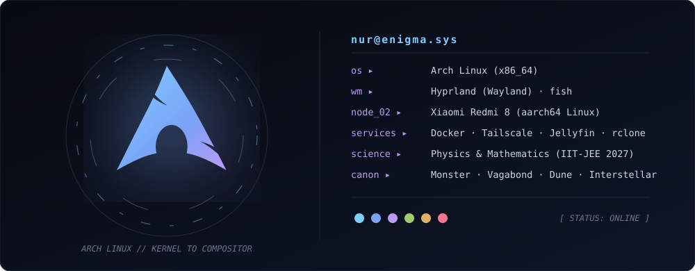

<!-- ===================================================================== -->
<!--                     NUR // ENIGMA — THE SILENT NODE                   -->
<!--           Replace YOUR_GITHUB_USERNAME with your actual handle        -->
<!-- ===================================================================== -->

<div align="center">

  <br/>

  <!-- ARABIC SALUTATION -->
  <h2>
    <samp>─── ٱلسَّلَامُ عَلَيْكُمْ ───</samp>
  </h2>
  <sub><i>Peace be upon you · Welcome to the quiet side of the machine</i></sub>

  <br/><br/>

  <!-- ENIGMATIC GRADIENT BANNER -->
  <!-- Tip: Upload assets/enigma-hero.svg to your repo and swap the src below to "./assets/enigma-hero.svg" for the custom animated SVG version -->
  

  <!-- WHISPER TYPING LINE -->
  <a href="https://github.com/YOUR_GITHUB_USERNAME">
    
  </a>

</div>

<br/>

---

<!-- ===================================================================== -->
<!--                   0x01 // THE ARCH LINUX MONOLITH                     -->
<!-- ===================================================================== -->

<!-- Tip: Upload assets/arch-monolith.svg and use  for the full animated orbital HUD -->

<table align="center">
<tr>
<td width="38%" align="center" valign="middle">

<br/>

<!-- BIG ARCH LINUX EMBLEM -->


<br/><br/>

<samp><b>ARCH LINUX // HYPRLAND</b></samp><br/>
<sub><code>x86_64</code> · <code>Wayland</code> · <code>fish</code></sub>

<br/>

</td>
<td width="62%" valign="middle">

```yaml
                nur@enigma
                ──────────────────────────────
                os       ▸  Arch Linux (x86_64)
                wm       ▸  Hyprland (Wayland)
                shell    ▸  fish
                lab      ▸  Redmi 8 Server (aarch64)
                mesh     ▸  Tailscale · OpenSSH · Docker
                pursuit  ▸  Physics & Math (JEE 2027)
                ethos    ▸  Zero bloat. Pure signal.
```

> *"I don't treat computers as opaque appliances. I strip them down to the bootloader, the kernel, and the raw laws of physics that make silicon think."*

</td>
</tr>
</table>

<br/>

<!-- ===================================================================== -->
<!--                   0x02 // THREE QUIET PILLARS                         -->
<!-- ===================================================================== -->

<div align="center">
  <samp>─── 0x01 // TRIAD OF FOCUS ───</samp>
</div>

<br/>

<table align="center">
<tr>
<td width="33%" align="center" valign="top">

<br/>

<br/><br/>
<samp><b>I. THE WORKSTATION</b></samp>
<br/>
<sub><code>Arch</code> · <code>Hyprland</code> · <code>Web</code></sub>
<br/><br/>
<sub>Crafting distraction-free Wayland environments, automated shell workflows, and clean, dark-themed web interfaces.</sub>
<br/><br/>

</td>
<td width="33%" align="center" valign="top">

<br/>

<br/><br/>
<samp><b>II. THE POCKET NODE</b></samp>
<br/>
<sub><code>aarch64</code> · <code>postmarketOS</code> · <code>Docker</code></sub>
<br/><br/>
<sub>Transforming a discarded Xiaomi Redmi 8 into a silent, self-hosted ARM64 Linux server running Jellyfin & rclone over Tailscale.</sub>
<br/><br/>

</td>
<td width="33%" align="center" valign="top">

<br/>

<br/><br/>
<samp><b>III. THE EQUATION</b></samp>
<br/>
<sub><code>Physics</code> · <code>Math</code> · <code>JEE 2027</code></sub>
<br/><br/>
<sub>Exploring classical mechanics, electromagnetism, calculus, and determinism through first-principles inquiry.</sub>
<br/><br/>

</td>
</tr>
</table>

<br/>

<!-- ===================================================================== -->
<!--               0x03 // MINIMAL INSTRUMENTATION DOCK                    -->
<!-- ===================================================================== -->

<div align="center">
  <samp>─── 0x02 // CORE INSTRUMENTS ───</samp>
  <br/><br/>

  <!-- Sleek, eye-soothing icon row instead of a noisy wall of 25 text badges -->
  <p align="center">
    
  </p>

  <samp>
    <sub>
      <code>Hyprland</code> &nbsp;·&nbsp;
      <code>Wayland</code> &nbsp;·&nbsp;
      <code>fish</code> &nbsp;·&nbsp;
      <code>postmarketOS</code> &nbsp;·&nbsp;
      <code>Alpine</code> &nbsp;·&nbsp;
      <code>Tailscale</code> &nbsp;·&nbsp;
      <code>Jellyfin</code> &nbsp;·&nbsp;
      <code>rclone</code>
    </sub>
  </samp>
</div>

<br/><br/>

<!-- ===================================================================== -->
<!--                   0x04 // TELEMETRY & PULSE                           -->
<!-- ===================================================================== -->

<div align="center">
  <samp>─── 0x03 // TELEMETRY ───</samp>
  <br/><br/>

  
  &nbsp;
  
</div>

<br/>

<!-- ===================================================================== -->
<!--            0x05 // EXPANDABLE DEEP ARCHIVE (ZERO CLUTTER)             -->
<!-- ===================================================================== -->

<details>
<summary align="center"><samp><b>[ + ] DECRYPT SYSTEM TOPOLOGY & COGNITIVE ARCHIVES</b></samp></summary>
<br/>

<div align="center">

<!-- Tip: Upload assets/dual-node.svg and replace the block below with  -->

```asciidoc
  ┌──────────────────────────────┐                     ┌──────────────────────────────┐
  │  ARCH WORKSTATION (x86_64)   │ ═══ WireGuard ════► │   REDMI 8 SERVER (aarch64)   │
  │  Hyprland · Wayland · fish   │     Tailscale       │  postmarketOS · Docker · SSH │
  └──────────────────────────────┘                     └──────────────────────────────┘
```

<br/>

$$i\hbar \frac{\partial}{\partial t}\Psi(\mathbf{r},t) = \hat{H}\Psi(\mathbf{r},t)$$

<br/>

| <samp>DOMAIN</samp> | <samp>RESONANCE</samp> |
| :--- | :--- |
| **Repositories** | `enigma-dotfiles` · `arm64-pocket-server` · `web-experiments` · `sys-automation` |
| **Narratives** | *Monster (Naoki Urasawa)* · *Vagabond (Takehiko Inoue)* · *Death Note* |
| **Cinema** | *Interstellar* · *Dune* |
| **Philosophy** | Strategic minimalism · Determinism & agency · First-principles thinking |

</div>

</details>

<br/><br/>

<!-- ===================================================================== -->
<!--                    0x06 // SILENT TRANSMISSION                        -->
<!-- ===================================================================== -->

<div align="center">

  <a href="mailto:notximan@proton.me">
    
  </a>
  &nbsp;&nbsp;
  <a href="https://instagram.com/i.not_iman">
    
  </a>
  &nbsp;&nbsp;
  

  <br/><br/>

  <samp>
    <sub>
      <code>[ EOF // NUR · ENIGMA ]</code> &nbsp;──&nbsp; <i>في أمان الله</i>
    </sub>
  </samp>

  

</div>
